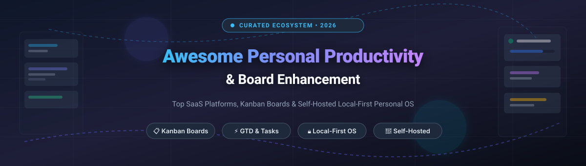
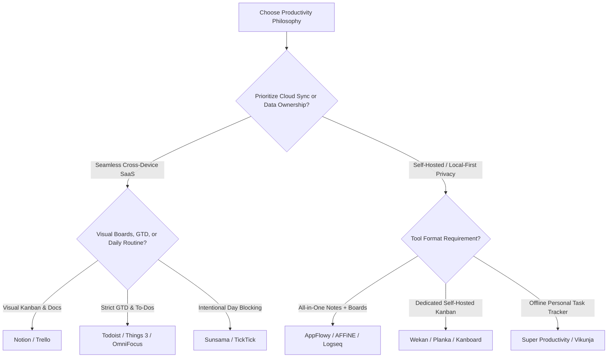

# Awesome Personal Productivity & Board Enhancement

  

  
  
  
  
  
  

> 🚀 A curated directory of top-tier SaaS platforms, board enhancement utilities, and self-hosted open-source software for personal productivity, task management, Getting Things Done (GTD), and Kanban workflows.

---

## 📊 Sector Overview & Market Dynamics

The global personal productivity and collaborative work management software market is estimated at **$71B–$81B in 2024–2025**, projected to grow at an aggressive **14% CAGR** towards 2030, driven by hybrid work patterns, AI-assisted execution, and local-first data ownership. 

The sector is **moderately fragmented**: while massive hyperscalers and incumbents (Microsoft, Atlassian, Notion) dominate horizontal workplace capture, individual and personal productivity remains fragmented with strong, highly loyal user bases distributed across specialized GTD apps, aesthetic daily planners, gamified trackers, and independent self-hosted/local-first ecosystems.

---

## 📑 Table of Contents

- [📊 Sector Overview & Market Dynamics](#-sector-overview--market-dynamics)
- [☁️ SaaS & Hosted Productivity Platforms](#️-saas--hosted-productivity-platforms)
- [💻 Open-Source GitHub Projects](#-open-source-github-projects)
  - [🏆 Full Personal Productivity Suites & Boards (Ranked by Stars)](#-full-personal-productivity-suites--boards-ranked-by-stars)
  - [🧩 Specialized Board Extensions & Tools](#-specialized-board-extensions--tools)
- [🎯 How to Choose Your Productivity Stack](#-how-to-choose-your-productivity-stack)
- [🤝 How to Contribute](#-how-to-contribute)
- [💖 Support & Sponsorship](#-support--sponsorship)
- [📈 Star History](#star-history)
- [📜 License](#-license)

---

## ☁️ SaaS & Hosted Productivity Platforms

Curated list of commercial SaaS task managers, board systems, and daily planning tools. Ranked by **Company Size / Valuation (Descending)**.

| 🏷️ Platform | 💵 Starting Tier Price | 🎁 Free Tier / Trial Limits | 🏢 Company Valuation / Revenue Est. | 📝 Description & Key Strengths |
| :--- | :--- | :--- | :--- | :--- |
| **[Microsoft To Do](https://to-do.office.com/)** | $6.00/user/mo (Microsoft 365 Business Basic for full business suite) | Free forever (100% free with any consumer Microsoft account; includes unlimited lists and sync) | ~$3.1 Trillion Market Cap / $245B+ Annual Revenue | Deeply integrated personal task manager; syncs with Outlook Tasks, Flagged Emails, and Microsoft 365 ecosystem. |
| **[Trello](https://trello.com/)** | $5.00/user/mo (Standard tier billed annually) | Free forever: up to 10 boards per workspace, unlimited cards, unlimited Power-Ups, 10MB per file attachment | ~$45 Billion Market Cap (Parent: Atlassian) / $4.4B+ Revenue | The pioneer of modern digital Kanban boards; flexible cards, checklist templates, and custom Power-Ups. |
| **[Notion](https://www.notion.com/)** | $10.00/user/mo (Plus tier billed annually) | Free forever: unlimited pages/blocks for individuals, up to 10 guests, 5MB file upload limit | ~$10 Billion Valuation / ~$350M+ ARR | All-in-one workspace blending databases, flexible Kanban boards, calendar views, wikis, and document nesting. |
| **[Todoist](https://todoist.com/)** | $4.00/user/mo (Pro tier billed annually) | Free forever: up to 5 active personal projects, 5 collaborators per project, 3 filter views, 1-week activity history | ~$40 Million ARR (Doist, bootstrapped) | Benchmark task manager recognized for natural-language quick-add input, recurring dates, and cross-platform synchronization. |
| **[Sunsama](https://www.sunsama.com/)** | $16.00/user/mo (Annual billing) | 14-day free trial with full feature access; no permanent free tier available | ~$15 Million - $25 Million Est. Valuation / ~$5M+ ARR | Premium daily planner and intentional calendar blocker combining to-dos, Google/Outlook Calendars, and a mindful shutdown routine. |
| **[Any.do](https://www.any.do/)** | $5.00/user/mo (Premium tier billed annually) | Free forever: basic task lists, reminder badges, calendar view; 7-day trial of Premium features | ~$15 Million - $20 Million Est. Valuation | Minimalist task manager with voice-to-text input, daily morning review ("Any.do Moment"), and calendar synchronization. |
| **[Things 3](https://culturedcode.com/things/)** | $9.99 (iOS) / $19.99 (iPadOS) / $49.99 (macOS) one-time purchase | 15-day free trial on macOS; no permanent free tier on mobile apps | ~$10 Million - $15 Million Est. Valuation (Cultured Code, bootstrapped) | Apple design award-winning GTD task app celebrated for thoughtful UI craftsmanship, quick entry, and local device-centric speed. |
| **[OmniFocus](https://www.omnigroup.com/omnifocus/)** | $9.99/mo (Subscription) or $74.99 one-time standard license | 14-day free trial across all platforms; no permanent free tier | ~$8 Million - $12 Million Est. Valuation (The Omni Group, bootstrapped) | Gold standard for strict Getting Things Done (GTD) practitioners; custom perspectives, deferred reviews, and nested hierarchies. |
| **[TickTick](https://ticktick.com/)** | $3.00/mo ($35.99 billed annually) | Free forever: up to 9 lists, 99 tasks per list, 19 checklists per task, basic Pomodoro timer | ~$5 Million - $10 Million Est. Valuation | Multi-purpose productivity app combining tasks, calendar blocking, customizable Pomodoro timer, and habit trackers in one interface. |
| **[Habitica](https://habitica.com/)** | $4.99/mo (Subscription for perks/gems) | Free forever: full gameplay, unlimited habits, dailies, to-dos, parties, and pet collections | ~$2 Million - $5 Million Est. Valuation | Gamified habit tracker and task manager transforming personal productivity into a retro 8-bit role-playing game with XP and gear. |

---

## 💻 Open-Source GitHub Projects

Explore the finest self-hosted and local-first open-source alternatives. Ranked by **GitHub Stars (Descending)**.

### 🏆 Full Personal Productivity Suites & Boards (Ranked by Stars)

- **[AppFlowy](https://github.com/AppFlowy-IO/AppFlowy)**   
  *Open-source Notion and Trello alternative built with Flutter and Rust.* Provides complete local-first data ownership, offline-native architecture, Kanban boards, table views, rich-text document editing, and end-to-end encryption.

- **[AFFiNE](https://github.com/toeverything/AFFiNE)**   
  *Next-generation privacy-first workspace blending docs, whiteboards, and personal task boards.* Supports shape drawing, multimodal mind mapping, and Kanban-style card groupings in a single local-first canvas.

- **[Joplin](https://github.com/laurent22/joplin)**   
  *Secure, open-source note-taking and to-do application with end-to-end encryption (E2EE).* Features markdown support, task alarms, geolocations, web clipper, and multi-device synchronization via Nextcloud, Dropbox, or S3.

- **[Logseq](https://github.com/logseq/logseq)**   
  *Privacy-first, local-first knowledge base and task outliner.* Employs Markdown and Org-mode plain text files with bidirectional linking, built-in task states (`TODO`/`DOING`/`DONE`), scheduled queries, and flashcards.

- **[Trilium Notes](https://github.com/zadam/trilium)**   
  *Hierarchical personal knowledge base and productivity system.* Built for personal knowledge graphs with task lists, scripting engine, revision history, encrypted subtrees, and self-hosted server sync.

- **[Super Productivity](https://github.com/super-productivity/super-productivity)**   
  *Advanced personal to-do list and time tracker with integrations.* Local-first, open-source application featuring time tracking, Pomodoro timer, break reminders, and direct sync with Jira, GitHub, and GitLab.

- **[Wekan](https://github.com/wekan/wekan)**   
  *Mature, self-hosted open-source Kanban board built on Meteor.* Offers granular permissions, swimlanes, card subtasks, email notifications, Docker/Snap installation, and seamless Trello export/import capabilities.

- **[Habitica](https://github.com/HabitRPG/habitica)**   
  *Open-source habit-tracking and productivity app governed by RPG game mechanics.* Self-hostable web and mobile codebase (Node.js/Vue/MongoDB) supporting parties, boss battles, and inventory rewards for real-world habit completion.

- **[Planka](https://github.com/plankanban/planka)**   
  *Modern, elegant, self-hosted real-time Kanban board.* Built with React and Redux, featuring subtasks, file attachments, custom background colors, user mentions, and simple Docker Compose deployment.

- **[Leantime](https://github.com/leantime/leantime)**   
  *Open-source strategic work and project management system designed for ADHD and neurodiverse minds.* Combines Kanban boards, milestone Gantt roadmaps, idea validation boards, and task time tracking.

- **[Kanboard](https://github.com/fguillot/kanboard)**   
  *Lightweight, minimalistic self-hosted Kanban board written in PHP.* Designed for speed, minimal server resource footprint, automated actions, subtask tracking, and extensive plugin support.

- **[Vikunja](https://github.com/go-vikunja/vikunja)**   
  *Self-hosted all-in-one to-do and task management application.* Features Kanban boards, Gantt charts, list views, CalDAV synchronization, subtasks, task reminders, and automated recurrence.

- **[Obsidian Kanban](https://github.com/mgmeyers/obsidian-kanban)**   
  *Markdown-backed Kanban board plugin for Obsidian.* Transforms Markdown files into interactive drag-and-drop boards without proprietary database locks; integrates with your personal PKM vault.

- **[Restyaboard](https://github.com/RestyaPlatform/board)**   
  *Enterprise-ready open-source Kanban and work organization platform.* Provides Trello import, card chat, calendar views, offline access, and customizable boards with REST APIs.

- **[Werkyn](https://github.com/rackstead/werkyn)**   
  *Open-source project collaboration platform (React 19 / PostgreSQL).* Features Kanban boards, BlockNote wiki docs, and real-time WebSocket sync (development preview).

- **[NeumanOS](https://github.com/travisjneuman/neumanos)**   
  *Privacy-first local-only personal operating system.* Built with React 19 and IndexedDB; integrates Kanban boards, habit streaks, ICS calendar sync, time tracking, and bring-your-own-key AI terminal.

- **[Kan-ductor](https://github.com/pdurlej/kan)**   
  *Focused AGPLv3 Trello alternative.* Self-hostable via Docker Compose with board templates, visibility controls, Trello JSON import, and activity audit logs.

- **[Atlantisboard](https://github.com/walster001/atlantisboard)**   
  *Self-hosted Kanban board (Bun / React / MongoDB).* Delivers real-time WebSocket collaboration, list permissions, checklists, and JSON board import.

---

### 🧩 Specialized Board Extensions & Tools

- **[Kanux](https://github.com/)** — 📝 Markdown-backed card organization for PKM environments with custom card IDs, incremental code prefixes, and board themes.
- **[Jotter](https://pypi.org/project/jotter-app/)** — ⚡ Local-first task manager with Git sync, Eisenhower matrix views, and MCP AI server support.
- **[Seeder](https://github.com/)** — ☁️ Cloudflare Workers-based project manager with Kanban views and MCP server capability.

---

## 🎯 How to Choose Your Productivity Stack

---

## 🤝 How to Contribute

Contributions are warmly welcomed! 🌟
1. Fork this repository.
2. Create a new branch: `git checkout -b feature/add-tool`.
3. Add or update tool listings following the established table / star-badge formatting.
4. Ensure descriptions are accurate, objective, and reference official project documentation.
5. Submit a Pull Request.

---

## 💖 Support & Sponsorship

Thank you so much for using and exploring this curated list! ✨

If you find this ecosystem guide helpful, please consider supporting the project:
- ⭐ **Star** this repository on GitHub to boost visibility
- 🍴 **Fork** and contribute new tools or updates
- 📢 **Share** with friends, colleagues, and productivity communities
- ☕ **Buy a coffee / Sponsor**: Support ongoing maintenance and curation on the [GitHub Sponsor Dashboard](https://github.com/sponsors/ishandutta2007)

---

## 📈 Star History

---

## 📜 License

To the extent possible under law, the maintainers and contributors have waived all copyright and related or neighboring rights to this work under [CC0 1.0 Universal (Public Domain Dedication)](http://creativecommons.org/publicdomain/zero/1.0/).
